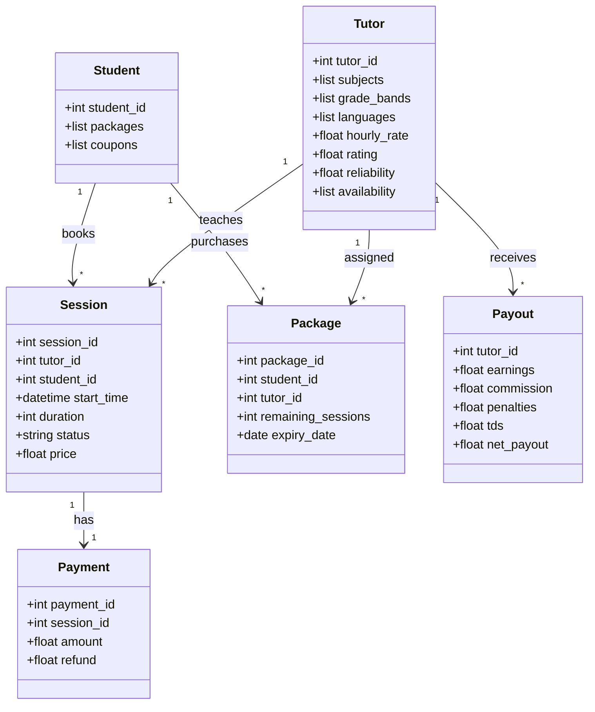
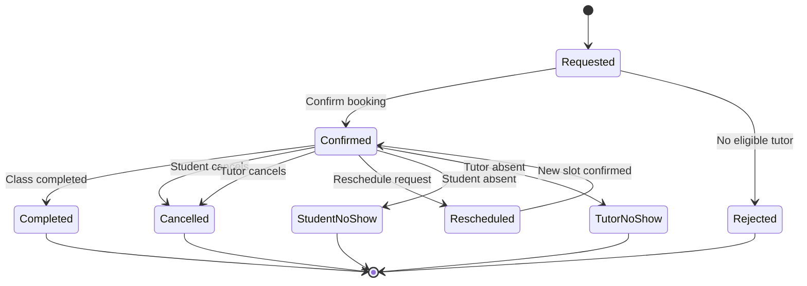

# CAPSTONE PROJECT – DESIGN DOCUMENT

## 1. Project Information

Project ID: PS-103

Team ID: T050

Project Title: Online Tutoring Marketplace –
Session Matching, Cancellation and Tutor Payout Engine

Domain: EdTech – Online Tutoring Marketplace

Programming Language: Python 3.10+

Team Size: 2 Members

## 2. Project Objective

The objective of this project is to develop a
Python-based online tutoring management engine.

The system will automatically match students with
suitable tutors based on subject, grade, language,
availability, rating and reliability.

It will also manage session bookings, cancellations,
rescheduling, pricing, discounts, tutor ratings,
and weekly tutor payouts.

The system will operate using input command files
without requiring a website or graphical interface.

## 3. Technologies Used (Planned)

- Python 3.10+ – Programming language
- Visual Studio Code – Code editor
- Git – Version control
- GitHub – Project repository
- CSV files – Input data storage
- pytest – Automated testing

## 4. Project Scope

The system will support:

1. Tutor registration and availability
2. Student session requests and tutor matching
3. Session confirmation and rescheduling
4. Student and tutor cancellations
5. Session pricing and discounts
6. Weekly tutor payouts
7. Tutor ratings and reliability
8. Session and payout reports
  

## 5. Project Glossary

| Term | Meaning |
|---|---|
| Tutor | A teacher who provides online classes |
| Student | A person who books a tutoring session |
| Session | One scheduled online tuition class |
| Session Request | A student's request for a class |
| Tutor Matching | Selecting the best suitable tutor |
| Availability Slot | Time when a tutor is free to teach |
| Booking | A confirmed tutoring session |
| Rescheduling | Changing a session to another time |
| Cancellation | Cancelling a booked session |
| No-show | Student or tutor failing to attend |
| Hourly Rate | Tutor's charge for 60 minutes |
| Surge Pricing | Extra charge during busy hours |
| Package | A prepaid group of 8 or 16 sessions |
| Discount | Reduction in the session price |
| Coupon | Credit applied to a future session |
| Platform Fee | Amount charged by the marketplace |
| Commission | Percentage deducted from tutor earnings |
| Payout | Money payable to a tutor |
| TDS | Tax Deducted at Source |
| Reliability Score | Score representing tutor dependability |
| Rating | Student feedback score from 1 to 5 |
| Demotion | Temporary exclusion due to low ratings |
| Suspension | Temporary restriction due to repeated late cancellations |
| Business Rule | A condition the system must follow |
| Edge Case | A special situation used to test correctness |
| Session Ledger | Record of sessions and related transactions |

## 6. Class Diagram

The following diagram shows the main classes
and their relationships in the tutoring system.

## 7. Session State Diagram

This diagram shows the different stages of a
tutoring session, from request to final outcome.

### State Descriptions

- Requested: Student asks for a tuition session.
- Confirmed: A tutor is assigned and booking is accepted.
- Completed: The tutoring session finishes.
- Cancelled: Student or tutor cancels the booking.
- Rescheduled: The booking moves to another time.
- Rejected: No suitable tutor is available.
- StudentNoShow: Student does not attend the class.
- TutorNoShow: Tutor does not attend the class.

Note: A reschedule may instead cancel the old booking
and create a new one, depending on BR-05.

## 8. Business Rules Register

### BR-01: Tutor Eligibility
- Match subject, grade band, language and availability.
- Grade bands: 1-5, 6-8, 9-10 and 11-12.
- Allowed session durations: 30, 45 and 60 minutes.
- Do not assign a tutor with a conflicting booking.

### BR-02: Tutor Ranking
- Score = rating * 10 + reliability * 5
          - (hourly_rate - cheapest_eligible_rate) / 100
- Select the tutor with the highest score.
- If scores tie, prefer fewer weekly sessions.
- If still tied, select the lower tutor ID.

### BR-03: Surge Pricing
- Apply 1.25x pricing on weekdays between 18:00
  and 21:00 when fewer than 3 tutors are eligible.
- Do not apply surge pricing to package sessions.

### BR-04: Session Packages
- 8-session package: 10% discount.
- 16-session package: 15% discount.
- Package sessions must use the same tutor.
- Packages expire after 60 days.
- Apply the package discount per session.

### BR-05: Student Cancellation and Rescheduling
- More than 24 hours before class: 100% refund.
- From 6 to 24 hours before class: 50% refund.
- Less than 6 hours before class: no refund.
- Free rescheduling requires more than 12 hours'
  notice, the same tutor and a new slot within 7 days.
- Allow a maximum of 2 reschedules per session.

### BR-06: Tutor Cancellation
- More than 24 hours: reliability decreases by 0.1.
- From 6 to 24 hours: reliability decreases by 0.3,
  with a Rs. 200 penalty.
- Less than 6 hours: reliability decreases by 0.5,
  with a Rs. 500 penalty and a 20% coupon for the
  student's next session.
- Keep reliability between 0 and 5.
- Increase reliability by 0.05 after completion.

### BR-07: No-Show Handling
- Student no-show: charge the full session amount
  after the tutor has waited 10 minutes.
- Tutor no-show: treat as a late tutor cancellation
  and issue a full student refund.

### BR-08: Weekly Platform Commission
- Fewer than 10 completed sessions: 25%.
- 10 to 24 completed sessions: 20%.
- 25 or more completed sessions: 15%.
- Apply the final weekly tier to all completed
  sessions in that week.

### BR-09: Tutor Payout
- Payout week runs from Monday to Sunday.
- Process weekly payouts on Wednesday.
- Net amount = earnings - commission - penalties.
- Deduct 10% TDS once annual cumulative payout
  crosses Rs. 30,000, including the crossing payout.
- Minimum payout is Rs. 500.
- Carry amounts below Rs. 500 into the next week.

### BR-10: Tutor Rating and Demotion
- Calculate average rating from the latest 20 ratings.
- If average falls below 3.5 after at least 10 ratings,
  demote the tutor from automatic matching.
- Restore matching eligibility after 5 completed
  direct-booking sessions.

### BR-11: Tutor Suspension
- If a tutor has 3 late cancellations within 30 days,
  suspend the tutor from automatic matching for 14 days.
- Previously confirmed sessions must still be honored.

### BR-12: Rule Precedence and Price Limits
- First check suspension and demotion.
- Then check tutor eligibility.
- Finally rank the eligible tutors.
- Pricing order: package discount, surge exclusion,
  then coupon discount.
- Apply no more than one coupon per session.
- Minimum final session price is Rs. 100.

## 9. Mandatory Edge Cases

### EC-01: Equal Tutor Scores
If two tutors have the same matching score and the
same number of weekly sessions, select the tutor
with the lower tutor ID.

Related Rule: BR-02

### EC-02: Surge Pricing at 20:30
A student requests a session at 20:30 on a weekday,
and exactly 3 tutors are eligible.

Expected Result:
Do not apply surge pricing because surge requires
fewer than 3 eligible tutors.

Related Rule: BR-03

### EC-03: Rescheduling at Exactly 12 Hours
A student requests rescheduling exactly 12 hours
before the session.

Expected Result:
Reject free rescheduling because the rule requires
MORE than 12 hours' notice.

Related Rule: BR-05

### EC-04: Annual Payout Crosses Rs. 30,000
A tutor's annual cumulative payout crosses
Rs. 30,000 during a weekly payout calculation.

Expected Result:
Apply the required 10% TDS to the crossing payout.

Related Rule: BR-09

### EC-05: Package Expiry
A package expires before a session booked using
that package is scheduled to take place.

Expected Result:
Check package validity according to the official
package-expiry rule and sample-data specification.
Do not silently extend the package.

Related Rule: BR-04

### EC-06: Tenth Rating Causes Demotion
A tutor receives their 10th rating, and the average
rating falls below 3.5.

Expected Result:
Demote the tutor from automatic matching.

Related Rule: BR-10

### EC-07: Rs. 499 Payout Carry-Forward
A tutor earns a net payout of Rs. 499 for one week.

Expected Result:
Do not release the payout. Carry Rs. 499 forward
to the next week. Calculate the next week's
commission tier using only that week's completed
sessions, then include the carried amount.

Related Rules: BR-08 and BR-09

### EC-08: Coupon on a Rs. 110 Session
A student uses a coupon on a 30-minute session
whose price before the coupon is Rs. 110.

Expected Result:
Apply the eligible coupon but never reduce the
final session price below Rs. 100.

Related Rule: BR-12
